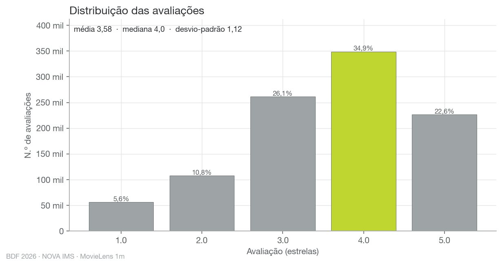
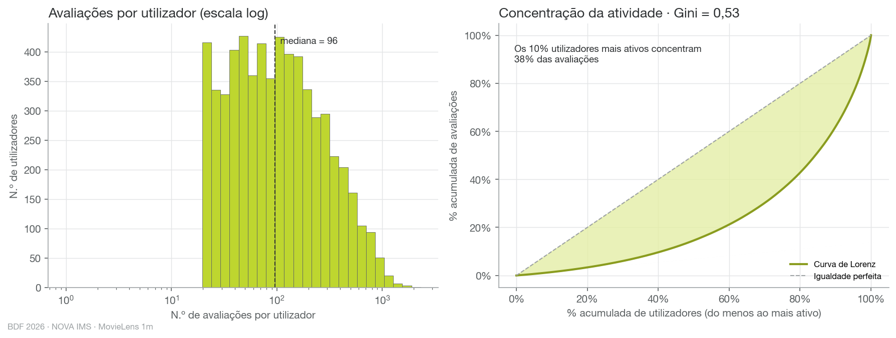
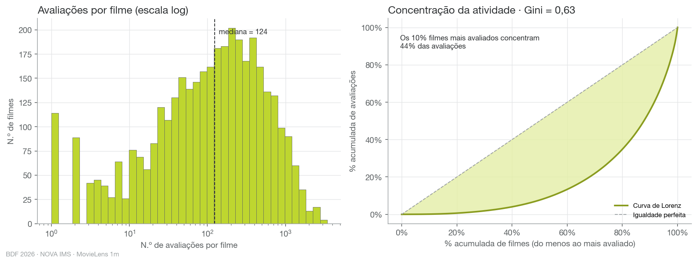
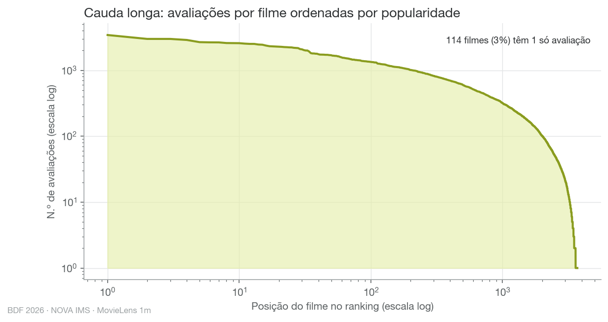
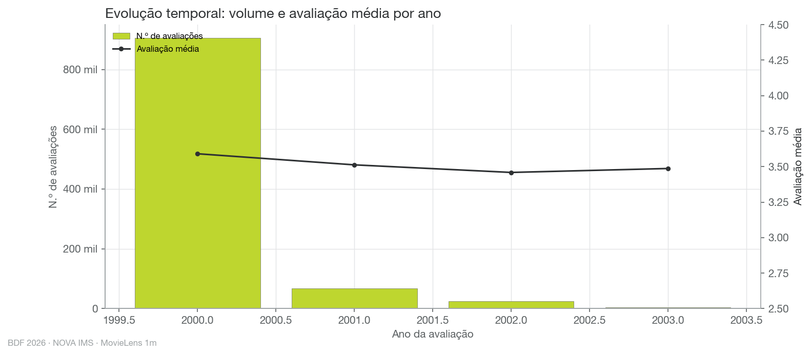
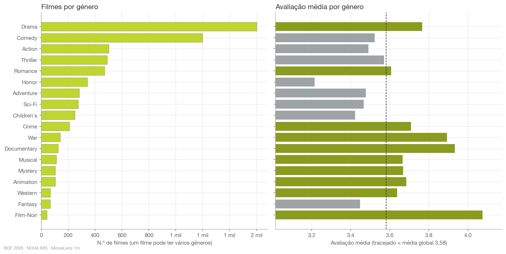
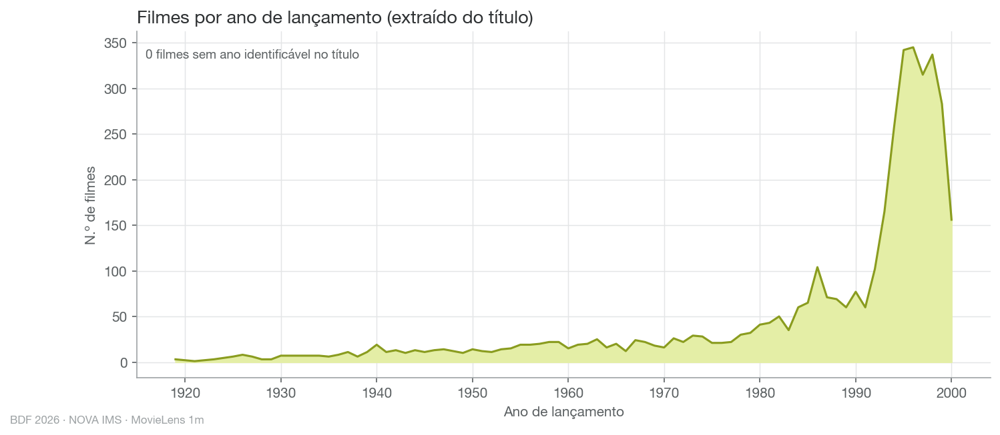
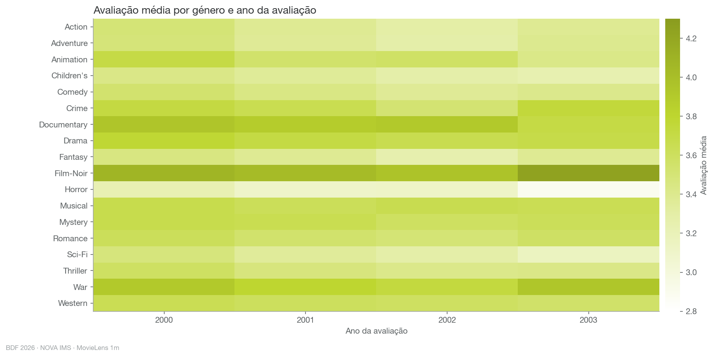
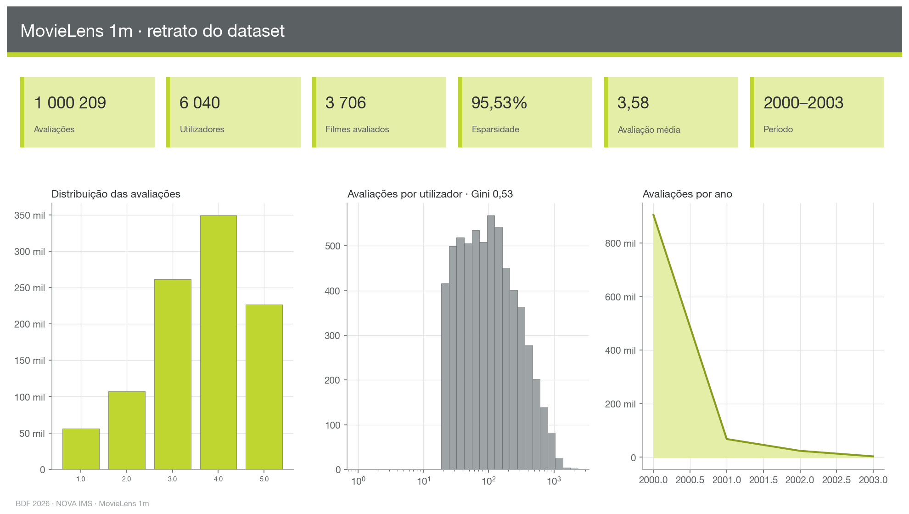

# Análise exploratória · MovieLens 1m

Gerado por `scripts/04_eda.py` em 1.0 s.

## Fontes

- **ratings** — `parquet: data/1m/parquet/ratings.parquet`
- **movies** — `parquet: data/1m/parquet/movies.parquet`

## Indicadores-chave

| Indicador | Valor |
|---|---|
| n_ratings | 1000209 |
| n_utilizadores | 6040 |
| n_filmes_avaliados | 3706 |
| n_filmes_catalogo | 3883 |
| filmes_sem_avaliacoes | 177 |
| esparsidade_pct | 95.532 |
| rating_media | 3.582 |
| rating_mediana | 4.0 |
| rating_desvio_padrao | 1.117 |
| rating_moda | 4.0 |
| ratings_por_user_min | 20 |
| ratings_por_user_mediana | 96.0 |
| ratings_por_user_media | 165.6 |
| ratings_por_user_p90 | 400.0 |
| ratings_por_user_max | 2314 |
| gini_user | 0.529 |
| pct_ratings_top10pct_user | 38.1 |
| ratings_por_movie_min | 1 |
| ratings_por_movie_mediana | 123.5 |
| ratings_por_movie_media | 269.9 |
| ratings_por_movie_p90 | 729.5 |
| ratings_por_movie_max | 3428 |
| gini_movie | 0.634 |
| pct_ratings_top10pct_movie | 44.4 |
| ano_primeiro_rating | 2000 |
| ano_ultimo_rating | 2003 |
| n_generos | 18 |
| filmes_sem_ano_no_titulo | 0 |

## Estrutura e qualidade das tabelas

| Tabela | Coluna | Linhas | Nulos | % nulos | Distintos (aprox.) |
|---|---|---|---|---|---|
| ratings | userId | 1000209 | 0 | 0.0 | 5921 |
| ratings | movieId | 1000209 | 0 | 0.0 | 4196 |
| ratings | rating | 1000209 | 0 | 0.0 | 5 |
| ratings | timestamp | 1000209 | 0 | 0.0 | 498578 |
| movies | movieId | 3883 | 0 | 0.0 | 4417 |
| movies | title | 3883 | 0 | 0.0 | 4574 |
| movies | genres | 3883 | 0 | 0.0 | 330 |

## Figuras

