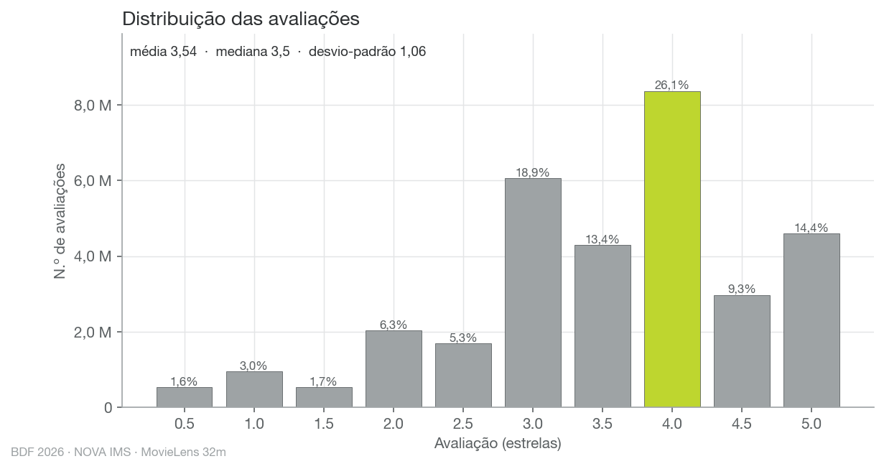
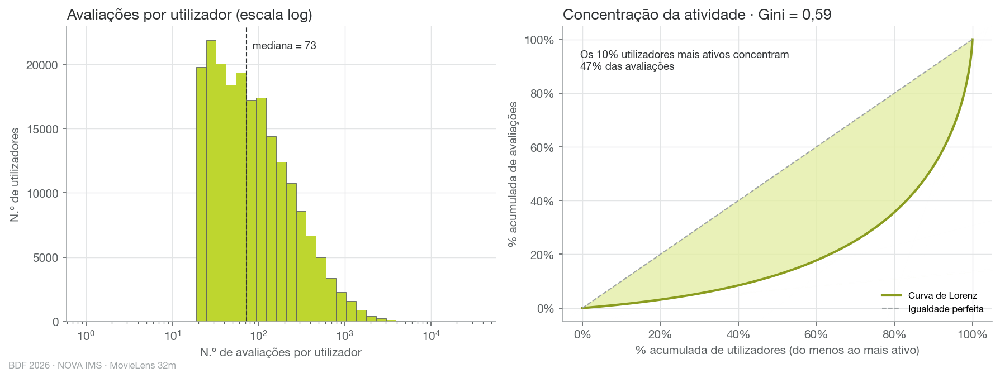
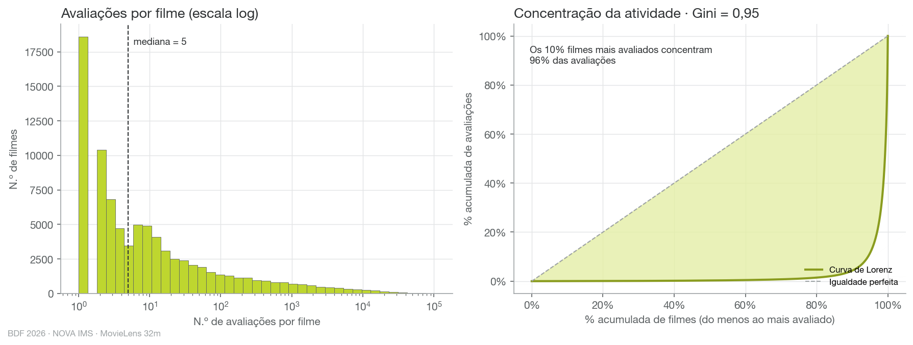
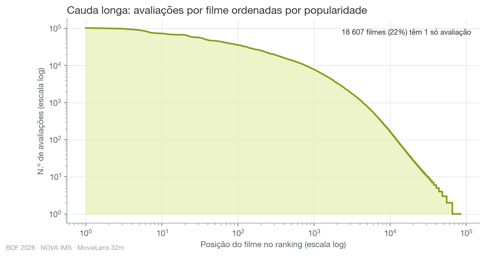
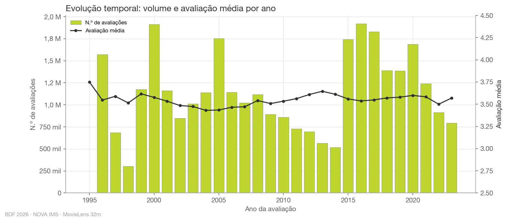
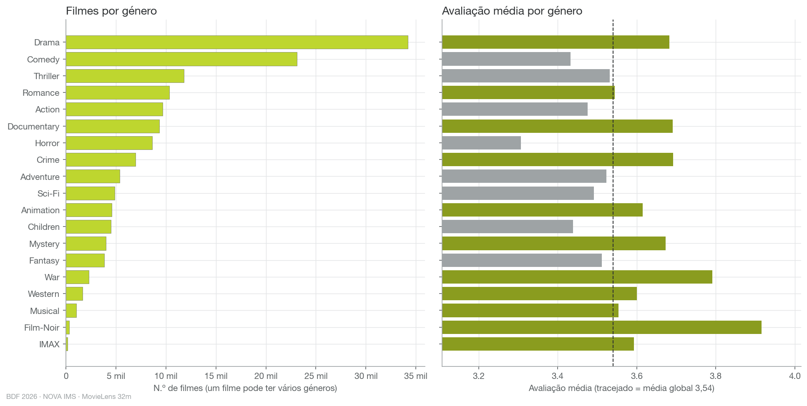
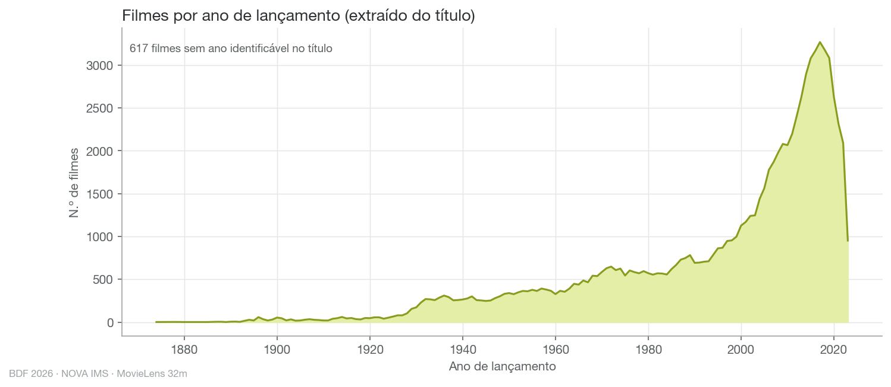
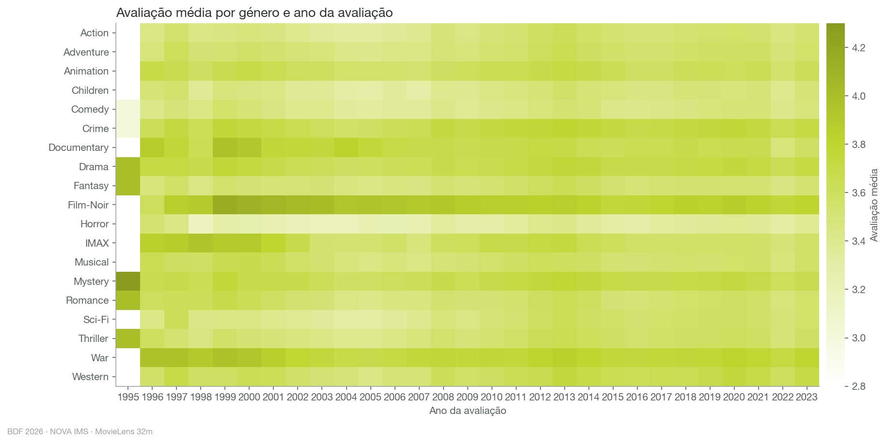
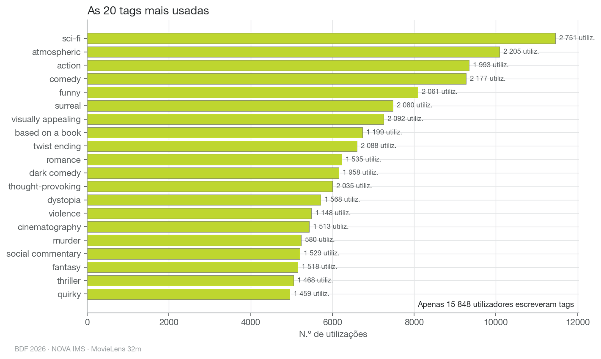
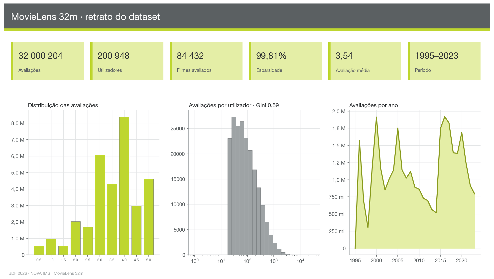

# Análise exploratória · MovieLens 32m

Gerado por `scripts/04_eda.py` em 3.1 s.

## Fontes

- **ratings** — `parquet: data/32m/parquet/ratings.parquet`
- **movies** — `parquet: data/32m/parquet/movies.parquet`
- **tags** — `parquet: data/32m/parquet/tags.parquet`
- **links** — `parquet: data/32m/parquet/links.parquet`

## Indicadores-chave

| Indicador | Valor |
|---|---|
| n_ratings | 32000204 |
| n_utilizadores | 200948 |
| n_filmes_avaliados | 84432 |
| n_filmes_catalogo | 87585 |
| filmes_sem_avaliacoes | 3153 |
| esparsidade_pct | 99.811 |
| rating_media | 3.54 |
| rating_mediana | 3.5 |
| rating_desvio_padrao | 1.059 |
| rating_moda | 4.0 |
| ratings_por_user_min | 20 |
| ratings_por_user_mediana | 73.0 |
| ratings_por_user_media | 159.2 |
| ratings_por_user_p90 | 364.0 |
| ratings_por_user_max | 33332 |
| gini_user | 0.594 |
| pct_ratings_top10pct_user | 47.2 |
| ratings_por_movie_min | 1 |
| ratings_por_movie_mediana | 5.0 |
| ratings_por_movie_media | 379.0 |
| ratings_por_movie_p90 | 248.90000000000873 |
| ratings_por_movie_max | 102929 |
| gini_movie | 0.952 |
| pct_ratings_top10pct_movie | 95.7 |
| ano_primeiro_rating | 1995 |
| ano_ultimo_rating | 2023 |
| n_generos | 19 |
| filmes_sem_ano_no_titulo | 617 |
| tags_total | 2000072 |
| tags_utilizadores | 15848 |
| tags_filmes | 51323 |

## Estrutura e qualidade das tabelas

| Tabela | Coluna | Linhas | Nulos | % nulos | Distintos (aprox.) |
|---|---|---|---|---|---|
| ratings | userId | 32000204 | 0 | 0.0 | 186412 |
| ratings | movieId | 32000204 | 0 | 0.0 | 70323 |
| ratings | rating | 32000204 | 0 | 0.0 | 11 |
| ratings | timestamp | 32000204 | 0 | 0.0 | 26163818 |
| movies | movieId | 87585 | 0 | 0.0 | 71783 |
| movies | title | 87585 | 0 | 0.0 | 91480 |
| movies | genres | 87585 | 0 | 0.0 | 1982 |
| tags | userId | 2000072 | 0 | 0.0 | 14023 |
| tags | movieId | 2000072 | 0 | 0.0 | 43102 |
| tags | tag | 2000072 | 0 | 0.0 | 103410 |
| tags | timestamp | 2000072 | 0 | 0.0 | 1157705 |
| links | movieId | 87585 | 0 | 0.0 | 71783 |
| links | imdbId | 87585 | 0 | 0.0 | 81591 |
| links | tmdbId | 87585 | 124 | 0.142 | 98768 |

## Figuras

