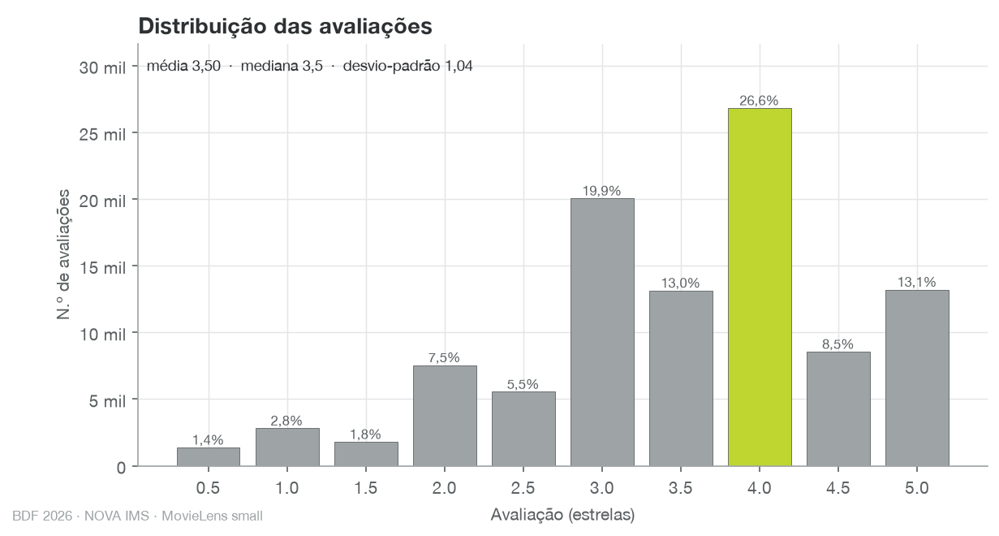
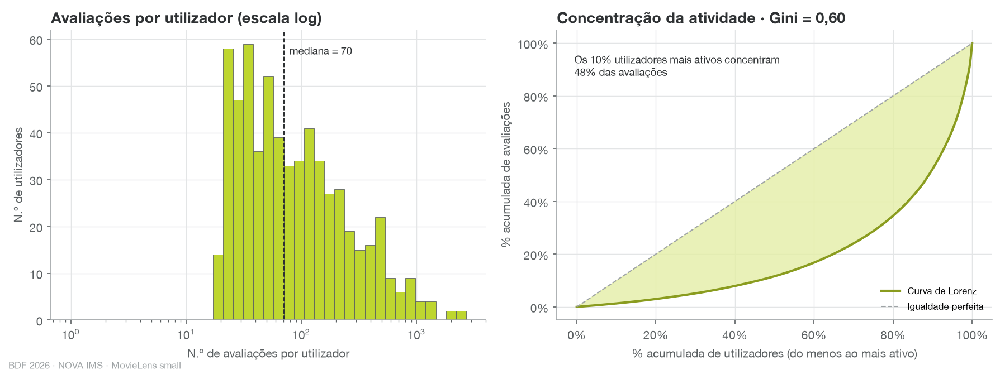
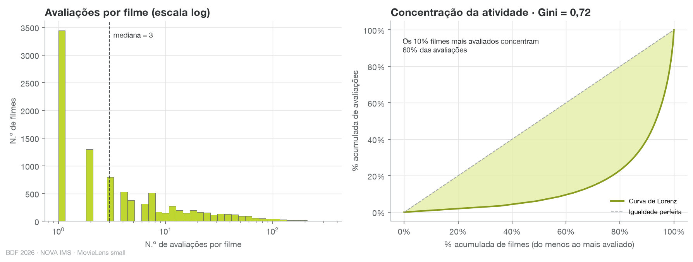
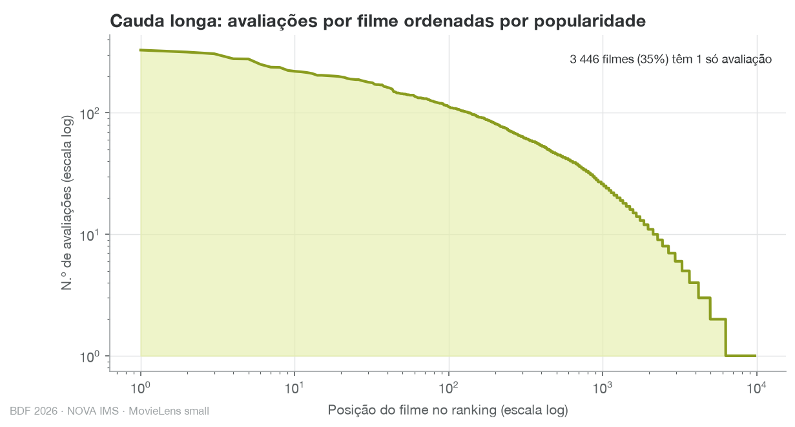
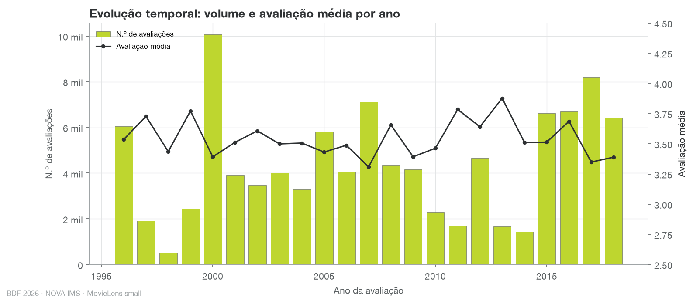
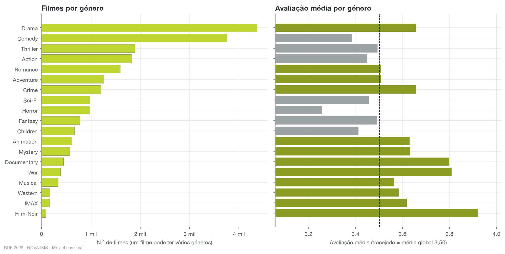
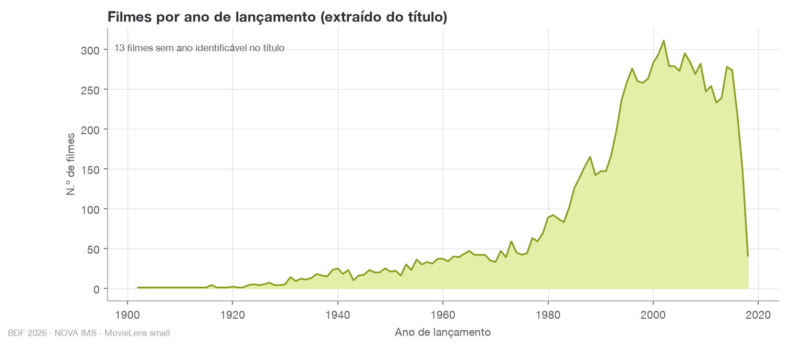
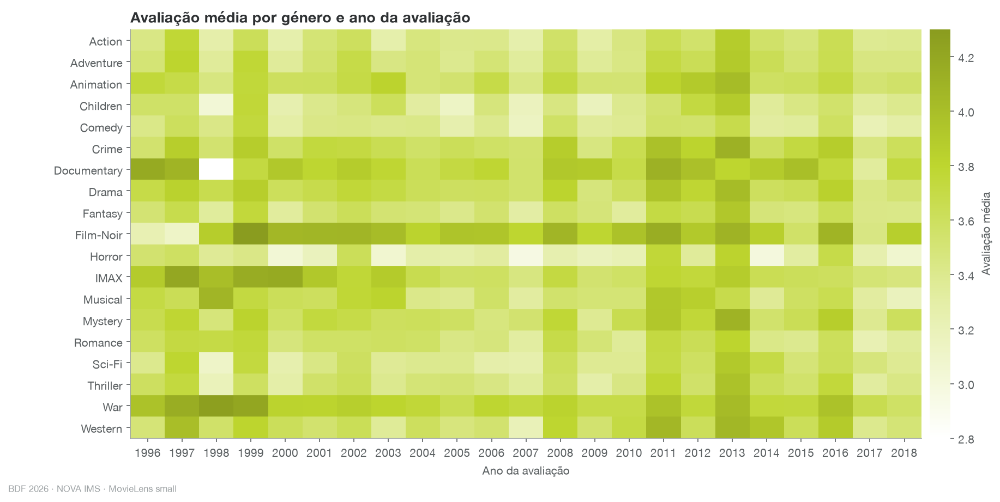
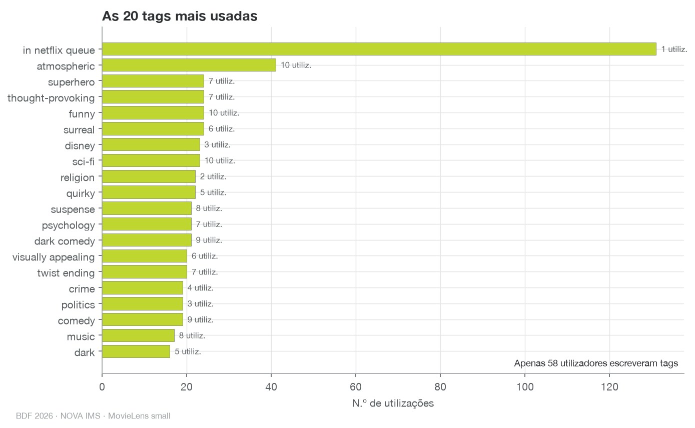
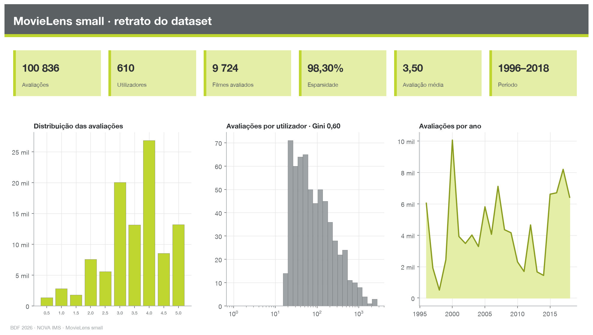

# Análise exploratória · MovieLens small

Gerado por `scripts/04_eda.py` em 1.2 s.

## Fontes

- **ratings** — `parquet: data/small/parquet/ratings.parquet`
- **movies** — `parquet: data/small/parquet/movies.parquet`
- **tags** — `parquet: data/small/parquet/tags.parquet`
- **links** — `parquet: data/small/parquet/links.parquet`

## Indicadores-chave

| Indicador | Valor |
|---|---|
| n_ratings | 100836 |
| n_utilizadores | 610 |
| n_filmes_avaliados | 9724 |
| n_filmes_catalogo | 9742 |
| filmes_sem_avaliacoes | 18 |
| esparsidade_pct | 98.3 |
| rating_media | 3.502 |
| rating_mediana | 3.5 |
| rating_desvio_padrao | 1.043 |
| rating_moda | 4.0 |
| ratings_por_user_min | 20 |
| ratings_por_user_mediana | 70.5 |
| ratings_por_user_media | 165.3 |
| ratings_por_user_p90 | 400.30000000000007 |
| ratings_por_user_max | 2698 |
| gini_user | 0.604 |
| pct_ratings_top10pct_user | 47.7 |
| ratings_por_movie_min | 1 |
| ratings_por_movie_mediana | 3.0 |
| ratings_por_movie_media | 10.4 |
| ratings_por_movie_p90 | 27.0 |
| ratings_por_movie_max | 329 |
| gini_movie | 0.716 |
| pct_ratings_top10pct_movie | 60.0 |
| ano_primeiro_rating | 1996 |
| ano_ultimo_rating | 2018 |
| n_generos | 19 |
| filmes_sem_ano_no_titulo | 13 |
| tags_total | 3683 |
| tags_utilizadores | 58 |
| tags_filmes | 1572 |

## Estrutura e qualidade das tabelas

| Tabela | Coluna | Linhas | Nulos | % nulos | Distintos (aprox.) |
|---|---|---|---|---|---|
| ratings | userId | 100836 | 0 | 0.0 | 609 |
| ratings | movieId | 100836 | 0 | 0.0 | 9341 |
| ratings | rating | 100836 | 0 | 0.0 | 10 |
| ratings | timestamp | 100836 | 0 | 0.0 | 88061 |
| movies | movieId | 9742 | 0 | 0.0 | 9341 |
| movies | title | 9742 | 0 | 0.0 | 9757 |
| movies | genres | 9742 | 0 | 0.0 | 971 |
| tags | userId | 3683 | 0 | 0.0 | 60 |
| tags | movieId | 3683 | 0 | 0.0 | 1580 |
| tags | tag | 3683 | 0 | 0.0 | 1571 |
| tags | timestamp | 3683 | 0 | 0.0 | 3383 |
| links | movieId | 9742 | 0 | 0.0 | 9341 |
| links | imdbId | 9742 | 0 | 0.0 | 9444 |
| links | tmdbId | 9742 | 8 | 0.082 | 9286 |

## Figuras

